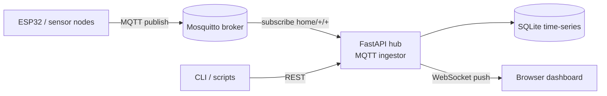

# MQTT Telemetry Hub

[](https://github.com/cliffhop23/mqtt-telemetry-hub/actions/workflows/ci.yml)
[](https://www.python.org/)
[](LICENSE)

A self-hosted ingestion platform for **MQTT IoT telemetry**: it subscribes to device topics, persists
time-series readings in SQLite, exposes a typed REST API, and streams live updates to a browser
dashboard over WebSockets.

Built to replace ad-hoc `mosquitto_sub` logging for a small home-lab fleet of ESP32 sensor nodes.

## Why

Home IoT devices publish tiny numeric messages (`home/esp32c3/rssi = -48`) many times per minute.
Cloud dashboards are heavy, and raw MQTT logging gives you no history or query API. This hub is a
single small container that adds storage, querying, and a live UI without a cloud dependency.

## Architecture



## Features

- **MQTT ingestion** — subscribes to `home/<device>/<metric>`, parses numeric payloads, stores them with timestamps.
- **REST API** — devices, latest values, and per-device history with metric filtering and limits.
- **WebSocket live stream** — dashboard receives readings as they arrive, with automatic reconnect.
- **SQLite storage** — zero-config, single-file database; WAL mode for concurrent reads.
- **Docker Compose** — hub + Mosquitto broker in one command.
- **Tested & linted** — pytest suite and ruff in CI on every push.

## Quick start

```bash
git clone https://github.com/cliffhop23/mqtt-telemetry-hub.git
cd mqtt-telemetry-hub
docker compose up --build
```

Open <http://localhost:8000>, then publish a test reading:

```bash
mosquitto_pub -h localhost -t home/esp32c3/rssi -m -48
mosquitto_pub -h localhost -t home/esp32c3/heap -m 199296
```

## Local development

```bash
python -m venv .venv && . .venv/bin/activate
pip install -r requirements.txt -r requirements-dev.txt
HUB_MQTT_HOST=localhost uvicorn app.main:app --reload
# or run the hub without a broker:
HUB_MQTT_ENABLED=0 uvicorn app.main:app --reload
```

Run the checks:

```bash
ruff check .
pytest -q
```

## API

| Method | Path | Description |
|---|---|---|
| `GET` | `/api/health` | Liveness, uptime, device count |
| `GET` | `/api/devices` | Devices with their latest metric values |
| `GET` | `/api/devices/{device}/latest` | Latest value per metric for one device |
| `GET` | `/api/devices/{device}/readings?metric=rssi&limit=100` | Historical readings |
| `WS` | `/ws` | Live reading stream (`{"type":"reading", ...}`) |

Example:

```bash
curl -s localhost:8000/api/devices | python -m json.tool
curl -s "localhost:8000/api/devices/esp32c3/readings?metric=rssi&limit=5"
```

## Configuration

| Env var | Default | Meaning |
|---|---|---|
| `HUB_DB` | `telemetry.db` | SQLite file path |
| `HUB_MQTT_HOST` | `localhost` | Broker host |
| `HUB_MQTT_PORT` | `1883` | Broker port |
| `HUB_MQTT_TOPIC` | `home/+/+` | Subscription filter |
| `HUB_MQTT_ENABLED` | `1` | Set `0` to run API-only |
| `HUB_MQTT_USER` | *(empty)* | Broker username (optional) |
| `HUB_MQTT_PASS` | *(empty)* | Broker password (optional) |

## ESP32 publisher

See [`firmware/esp32c3_mqtt.ino`](firmware/esp32c3_mqtt.ino) for an Arduino sketch that publishes
RSSI, heap, and uptime over authenticated MQTT. Any publisher that emits numeric payloads on
`home/<device>/<metric>` works.

## Roadmap

- [ ] Retention policy and downsampling
- [ ] Prometheus `/metrics` endpoint
- [ ] Alert rules (threshold → webhook/ntfy)
- [ ] Multi-broker support

## License

MIT © 2026 Thomas Hopkinson
